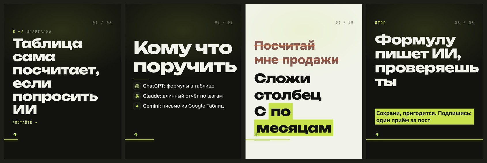

# Стиль «атмосфера»

> Собрано `tools_style.py` из кода 16.09.2026.
> Источник правды — `card.ДИЗАЙНЫ["атмосфера"]` и `форматы.py`; править там, потом пересобрать.

**Что это:** свечение сверху, пустота, заголовок прижат к низу

## Откуда взят

Списан с чужой карусели: **@ty.prompts.ai (AA Studio)**.
Кадры источника — `/Users/xiix/4xSoft/исследование-тикток-карусели/слайды/30_ty.prompts.ai`, разбор — `data/выгрузка/референсы/РАЗБОР.md`.
Переносились приёмы и параметры; имена, тексты и почерк автора — нет.

## Пример

Один и тот же пост во всех стилях — поэтому разница между папками это разница стилей, а не текста.

Кадры по отдельности, в полном размере — в `кадры/`.

## Дизайн-система

### 1. Палитра

Роли общие для всех стилей канала и не меняются: фон `#12130F`, текст `#F1F3EA`, акцент `#C7E24B`, ржавый `#E2703A`.

Тон кадров: обложка — тёмный, список — тёмный, правка — светлый, финал — тёмный.

Своих цветов не вводит — берёт канальные.

### 2. Иерархия

Гарнитуры: Unbounded 800, Golos 400, JB 400.

Множители кеглей: заголовок ×1.24, мысль ×0.94, над ×0.92.

### 3. Размеры и начертания

Своих кеглей не задаёт, считается от вёрстки.

### 4. Радиусы

прямые углы, радиусов нет

### 5. Границы

границ нет

### 6. Тени и свечения

теней и свечений нет

### 7. Сетка и воздух

Плотность чернил: обложка 10.4%, список 9.7%, правка 17.8%, финал 17.1% (норма 8–15%).

### 8. Карточки

Подложек под текстом нет, текст лежит прямо на холсте.

### 9. Декор

Разрядка подписей, своя вёрстка обложки.

### 10. Картинки

Кот и значки инструментов общие для всех стилей: значки вшиваются данными (`file://` Chrome молча не рисует), кот берётся из `assets/mascot/позы`.

### 11. Адаптация под наш кадр 1620×2160

Форматы: 3к4 и квадрат. Фон холста: любой из общих.

В ротации: **да**

Запретов нет.

## Замеры против наших порогов

Пороги сняты на живых кадрах, а не взяты из веб-рекомендаций: в ленте кадр уменьшен втрое.

| кадр | контраст (норма ≥8:1) | акцент (норма 4–6%) | чернила (норма 8–15%) |
|---|---|---|---|
| обложка | 16.1:1 | 0.21% | 10.4% |
| список | 16.1:1 | 0.25% | 9.7% |
| правка | 16.4:1 | 10.54% | 17.8% |
| финал | 15.4:1 | 7.97% | 17.1% |

## Схожесть с другими стилями

Считается по отрисованным кадрам: структура (куда легли чернила) весит 0,6, палитра — 0,4. Выше 95% значит, что в ленте это читается как один дизайн.

| стиль | общая | структура | палитра |
|---|---|---|---|
| брутальный | 73.3% | 58.0% | 96.4% |
| манифест | 73.2% | 57.1% | 97.5% |
| плакат | 65.9% | 45.9% | 96.1% |

Полная матрица — в `../README.md`.
