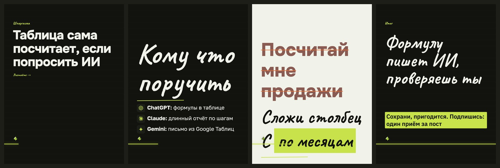

# Стиль «заметка»

> Собрано `tools_style.py` из кода 16.09.2026.
> Источник правды — `card.ДИЗАЙНЫ["заметка"]` и `форматы.py`; править там, потом пересобрать.

**Что это:** рукописный акцент Caveat поверх аккуратного текста

## Откуда взят

Наш собственный, без чужого источника.

## Пример

Один и тот же пост во всех стилях — поэтому разница между папками это разница стилей, а не текста.

Кадры по отдельности, в полном размере — в `кадры/`.

## Дизайн-система

### 1. Палитра

Роли общие для всех стилей канала и не меняются: фон `#12130F`, текст `#F1F3EA`, акцент `#C7E24B`, ржавый `#E2703A`.

Тон кадров: обложка — тёмный, список — тёмный, правка — светлый, финал — тёмный.

Своих цветов не вводит — берёт канальные.

### 2. Иерархия

Гарнитуры: Caveat 700, Golos 400, Golos 700.

Множители кеглей: заголовок ×1.75, мысль ×0.98, над ×1.3, огонь ×1.5.

### 3. Размеры и начертания

Своих кеглей не задаёт, считается от вёрстки.

### 4. Радиусы

`99px`

### 5. Границы

`99px`

### 6. Тени и свечения

теней и свечений нет

### 7. Сетка и воздух

Плотность чернил: обложка 6.5%, список 8.0%, правка 20.5%, финал 12.8% (норма 8–15%).

### 8. Карточки

Есть подложки под текстом — см. `border-radius` выше.

### 9. Декор

Разрядка подписей.

### 10. Картинки

Кот и значки инструментов общие для всех стилей: значки вшиваются данными (`file://` Chrome молча не рисует), кот берётся из `assets/mascot/позы`.

### 11. Адаптация под наш кадр 1620×2160

Форматы: 3к4 и квадрат. Фон холста: любой из общих.

В ротации: **нет** — включается в `форматы.ДИЗАЙНЫ_ОК`.

Запретов нет.

## Замеры против наших порогов

Пороги сняты на живых кадрах, а не взяты из веб-рекомендаций: в ленте кадр уменьшен втрое.

| кадр | контраст (норма ≥8:1) | акцент (норма 4–6%) | чернила (норма 8–15%) |
|---|---|---|---|
| обложка | 16.1:1 | 0.21% | 6.5% |
| список | 16.1:1 | 0.38% | 8.0% |
| правка | 5.0:1 | 16.4% | 20.5% |
| финал | 12.5:1 | 7.95% | 12.8% |

## Схожесть с другими стилями

Считается по отрисованным кадрам: структура (куда легли чернила) весит 0,6, палитра — 0,4. Выше 95% значит, что в ленте это читается как один дизайн.

| стиль | общая | структура | палитра |
|---|---|---|---|
| журнал | 81.0% | 70.0% | 97.6% |
| чертёж | 71.4% | 55.7% | 94.9% |
| неон | 70.4% | 54.3% | 94.5% |

Полная матрица — в `../README.md`.
