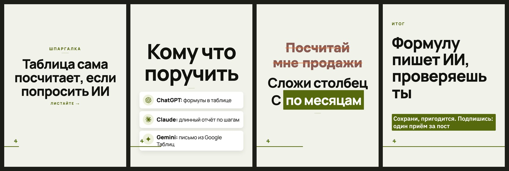

# Стиль «каталог»

> Собрано `tools_style.py` из кода 16.09.2026.
> Источник правды — `card.ДИЗАЙНЫ["каталог"]` и `форматы.py`; править там, потом пересобрать.

**Что это:** светлый кадр, пилюли-теги и карточки с номером и долей

## Откуда взят

Списан с чужой карусели: **@emirailab**, 466 тыс. просмотров.
Кадры источника — `/Users/xiix/4xSoft/исследование-тикток-карусели/слайды/12_emirailab`, разбор — `data/выгрузка/референсы/РАЗБОР.md`.
Переносились приёмы и параметры; имена, тексты и почерк автора — нет.

## Пример

Один и тот же пост во всех стилях — поэтому разница между папками это разница стилей, а не текста.

Кадры по отдельности, в полном размере — в `кадры/`.

## Дизайн-система

### 1. Палитра

Роли общие для всех стилей канала и не меняются: фон `#12130F`, текст `#F1F3EA`, акцент `#C7E24B`, ржавый `#E2703A`.

Тон кадров: обложка — светлый, список — светлый, правка — светлый, финал — светлый.

Свои цвета в CSS: `#EDF1DC`, `#FFFFFF`

### 2. Иерархия

Гарнитуры: Manrope 800, Manrope 400, Onest 800.

Множители кеглей: заголовок ×1.25, мысль ×0.94, над ×0.9.

### 3. Размеры и начертания

Своих кеглей не задаёт, считается от вёрстки.

### 4. Радиусы

`22px`, `26px`, `50%`, `999px`

### 5. Границы

`22px`, `26px`, `50%`, `999px`, `none`, `rgba(18,19,15,.06)`

### 6. Тени и свечения

`0 10px 26px rgba(18,19,15,.07)`, `0 18px 42px rgba(18,19,15,.08)`, `brightness(.45) saturate(1.4)`, `none`

### 7. Сетка и воздух

Плотность чернил: обложка 6.5%, список 8.4%, правка 13.0%, финал 15.2% (норма 8–15%).

### 8. Карточки

Есть подложки под текстом — см. `border-radius` выше.

### 9. Декор

Свечения и тени, разрядка подписей, пилюли-метки, своя вёрстка обложки.

### 10. Картинки

Кот и значки инструментов общие для всех стилей: значки вшиваются данными (`file://` Chrome молча не рисует), кот берётся из `assets/mascot/позы`.

### 11. Адаптация под наш кадр 1620×2160

Форматы: 3к4 и квадрат. Фон холста: чистый.

В ротации: **да**

Запреты:

- Д-01: нельзя вёрстки «было», «стрелка» на тёмных кадрах
- Д-02: нельзя вёрстки «против»

## Замеры против наших порогов

Пороги сняты на живых кадрах, а не взяты из веб-рекомендаций: в ленте кадр уменьшен втрое.

| кадр | контраст (норма ≥8:1) | акцент (норма 4–6%) | чернила (норма 8–15%) |
|---|---|---|---|
| обложка | 16.6:1 | 0.11% | 6.5% |
| список | 16.6:1 | 0.09% | 8.4% |
| правка | 5.5:1 | 3.77% | 13.0% |
| финал | 5.5:1 | 0.31% | 15.2% |

## Схожесть с другими стилями

Считается по отрисованным кадрам: структура (куда легли чернила) весит 0,6, палитра — 0,4. Выше 95% значит, что в ленте это читается как один дизайн.

| стиль | общая | структура | палитра |
|---|---|---|---|
| манифест | 13.9% | 0.0% | 34.7% |
| атмосфера | 13.8% | 0.0% | 34.6% |
| плакат | 13.6% | 0.0% | 34.1% |

Полная матрица — в `../README.md`.
