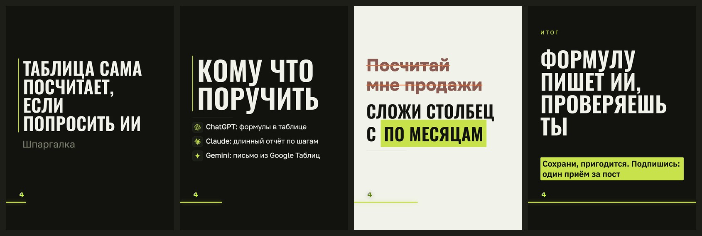

# Стиль «манифест»

> Собрано `tools_style.py` из кода 16.09.2026.
> Источник правды — `card.ДИЗАЙНЫ["манифест"]` и `форматы.py`; править там, потом пересобрать.

**Что это:** узкие заглавные во всю ширину, линейка слева, без акцента

## Откуда взят

Списан с чужой карусели: **@neuro.ks**, 641 тыс. просмотров.
Кадры источника — `data/выгрузка/референсы/01-neuro.ks`, разбор — `data/выгрузка/референсы/РАЗБОР.md`.
Переносились приёмы и параметры; имена, тексты и почерк автора — нет.

## Пример

Один и тот же пост во всех стилях — поэтому разница между папками это разница стилей, а не текста.

Кадры по отдельности, в полном размере — в `кадры/`.

## Дизайн-система

### 1. Палитра

Роли общие для всех стилей канала и не меняются: фон `#12130F`, текст `#F1F3EA`, акцент `#C7E24B`, ржавый `#E2703A`.

Тон кадров: обложка — тёмный, список — тёмный, правка — светлый, финал — тёмный.

Своих цветов не вводит — берёт канальные.

### 2. Иерархия

Гарнитуры: Oswald 600, Golos 400.

Множители кеглей: заголовок ×1.18, мысль ×0.92, над ×0.9.

### 3. Размеры и начертания

Своих кеглей не задаёт, считается от вёрстки.

### 4. Радиусы

`4px`

### 5. Границы

`4px`

### 6. Тени и свечения

теней и свечений нет

### 7. Сетка и воздух

Плотность чернил: обложка 8.3%, список 9.2%, правка 14.3%, финал 17.1% (норма 8–15%).

### 8. Карточки

Есть подложки под текстом — см. `border-radius` выше.

### 9. Декор

Разрядка подписей, своя вёрстка обложки.

### 10. Картинки

Кот и значки инструментов общие для всех стилей: значки вшиваются данными (`file://` Chrome молча не рисует), кот берётся из `assets/mascot/позы`.

### 11. Адаптация под наш кадр 1620×2160

Форматы: 3к4 и квадрат. Фон холста: любой из общих.

В ротации: **да**

Запреты:

- Д-05: нельзя в формате квадрат

## Замеры против наших порогов

Пороги сняты на живых кадрах, а не взяты из веб-рекомендаций: в ленте кадр уменьшен втрое.

| кадр | контраст (норма ≥8:1) | акцент (норма 4–6%) | чернила (норма 8–15%) |
|---|---|---|---|
| обложка | 16.1:1 | 0.23% | 8.3% |
| список | 16.1:1 | 0.34% | 9.2% |
| правка | 16.0:1 | 9.05% | 14.3% |
| финал | 15.4:1 | 7.97% | 17.1% |

## Схожесть с другими стилями

Считается по отрисованным кадрам: структура (куда легли чернила) весит 0,6, палитра — 0,4. Выше 95% значит, что в ленте это читается как один дизайн.

| стиль | общая | структура | палитра |
|---|---|---|---|
| неон | 77.4% | 64.6% | 96.6% |
| редакционный | 75.7% | 62.2% | 96.1% |
| швейцарский | 74.2% | 59.6% | 96.1% |

Полная матрица — в `../README.md`.
