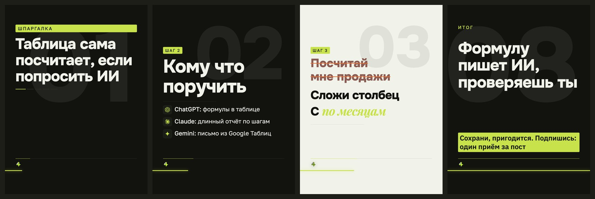

# Стиль «пособие»

> Собрано `tools_style.py` из кода 16.09.2026.
> Источник правды — `card.ДИЗАЙНЫ["пособие"]` и `форматы.py`; править там, потом пересобрать.

**Что это:** курсивный засечный акцент и призрачный номер в углу

## Откуда взят

Списан с чужой карусели: **@neuro.ks**, 469 тыс. просмотров.
Кадры источника — `data/выгрузка/референсы/05-neuro.ks`, разбор — `data/выгрузка/референсы/РАЗБОР.md`.
Переносились приёмы и параметры; имена, тексты и почерк автора — нет.

## Пример

Один и тот же пост во всех стилях — поэтому разница между папками это разница стилей, а не текста.

Кадры по отдельности, в полном размере — в `кадры/`.

## Дизайн-система

### 1. Палитра

Роли общие для всех стилей канала и не меняются: фон `#12130F`, текст `#F1F3EA`, акцент `#C7E24B`, ржавый `#E2703A`.

Тон кадров: обложка — тёмный, список — тёмный, правка — светлый, финал — тёмный.

Своих цветов не вводит — берёт канальные.

### 2. Иерархия

Гарнитуры: Onest 800, Golos 400, PlayfairIt 700.

Множители кеглей: заголовок ×0.96, мысль ×0.92, над ×0.88.

### 3. Размеры и начертания

Своих кеглей не задаёт, считается от вёрстки.

### 4. Радиусы

`0`, `2px`, `6px`

### 5. Границы

`0`, `2px`, `6px`

### 6. Тени и свечения

теней и свечений нет

### 7. Сетка и воздух

Плотность чернил: обложка 9.8%, список 6.2%, правка 11.6%, финал 14.0% (норма 8–15%).

### 8. Карточки

Есть подложки под текстом — см. `border-radius` выше.

### 9. Декор

Разрядка подписей, своя вёрстка обложки.

### 10. Картинки

Кот и значки инструментов общие для всех стилей: значки вшиваются данными (`file://` Chrome молча не рисует), кот берётся из `assets/mascot/позы`.

### 11. Адаптация под наш кадр 1620×2160

Форматы: 3к4 и квадрат. Фон холста: любой из общих.

В ротации: **да**

Запреты:

- Д-04: нельзя вёрстки «шаг»
- Д-03: без подсветки слов на светлых кадрах (снимает предполёт)

## Замеры против наших порогов

Пороги сняты на живых кадрах, а не взяты из веб-рекомендаций: в ленте кадр уменьшен втрое.

| кадр | контраст (норма ≥8:1) | акцент (норма 4–6%) | чернила (норма 8–15%) |
|---|---|---|---|
| обложка | 16.0:1 | 3.42% | 9.8% |
| список | 16.1:1 | 0.72% | 6.2% |
| правка | 5.1:1 | 3.78% | 11.6% |
| финал | 12.6:1 | 8.15% | 14.0% |

## Схожесть с другими стилями

Считается по отрисованным кадрам: структура (куда легли чернила) весит 0,6, палитра — 0,4. Выше 95% значит, что в ленте это читается как один дизайн.

| стиль | общая | структура | палитра |
|---|---|---|---|
| швейцарский | 67.2% | 47.5% | 96.8% |
| манифест | 66.9% | 48.5% | 94.6% |
| фирменный | 66.8% | 46.8% | 96.9% |

Полная матрица — в `../README.md`.
