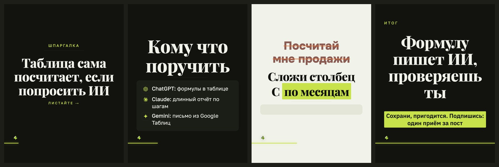

# Стиль «редакционный»

> Собрано `tools_style.py` из кода 16.09.2026.
> Источник правды — `card.ДИЗАЙНЫ["редакционный"]` и `форматы.py`; править там, потом пересобрать.

**Что это:** центрированная колонка, линейка, карточка и пилюли-метки

## Откуда взят

Наш собственный, без чужого источника.

## Пример

Один и тот же пост во всех стилях — поэтому разница между папками это разница стилей, а не текста.

Кадры по отдельности, в полном размере — в `кадры/`.

## Дизайн-система

### 1. Палитра

Роли общие для всех стилей канала и не меняются: фон `#12130F`, текст `#F1F3EA`, акцент `#C7E24B`, ржавый `#E2703A`.

Тон кадров: обложка — тёмный, список — тёмный, правка — светлый, финал — тёмный.

Своих цветов не вводит — берёт канальные.

### 2. Иерархия

Гарнитуры: Playfair 800, Golos 400, PlayfairIt 700.

Множители кеглей: заголовок ×1.1, мысль ×0.98, над ×0.92.

### 3. Размеры и начертания

Своих кеглей не задаёт, считается от вёрстки.

### 4. Радиусы

`24px`, `50%`, `999px`

### 5. Границы

`24px`, `50%`, `999px`

### 6. Тени и свечения

`none`

### 7. Сетка и воздух

Плотность чернил: обложка 5.7%, список 6.4%, правка 11.2%, финал 14.6% (норма 8–15%).

### 8. Карточки

Есть подложки под текстом — см. `border-radius` выше.

### 9. Декор

Свечения и тени, разрядка подписей, пилюли-метки, своя вёрстка обложки.

### 10. Картинки

Кот и значки инструментов общие для всех стилей: значки вшиваются данными (`file://` Chrome молча не рисует), кот берётся из `assets/mascot/позы`.

### 11. Адаптация под наш кадр 1620×2160

Форматы: 3к4 и квадрат. Фон холста: любой из общих.

В ротации: **да**

Запретов нет.

## Замеры против наших порогов

Пороги сняты на живых кадрах, а не взяты из веб-рекомендаций: в ленте кадр уменьшен втрое.

| кадр | контраст (норма ≥8:1) | акцент (норма 4–6%) | чернила (норма 8–15%) |
|---|---|---|---|
| обложка | 16.1:1 | 0.33% | 5.7% |
| список | 16.1:1 | 0.24% | 6.4% |
| правка | 5.2:1 | 7.88% | 11.2% |
| финал | 12.6:1 | 7.97% | 14.6% |

## Схожесть с другими стилями

Считается по отрисованным кадрам: структура (куда легли чернила) весит 0,6, палитра — 0,4. Выше 95% значит, что в ленте это читается как один дизайн.

| стиль | общая | структура | палитра |
|---|---|---|---|
| манифест | 75.7% | 62.2% | 96.1% |
| неон | 73.6% | 58.4% | 96.4% |
| чертёж | 70.6% | 52.4% | 98.0% |

Полная матрица — в `../README.md`.
