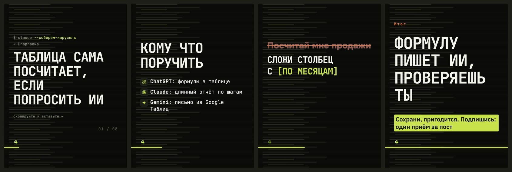

# Стиль «терминал»

> Собрано `tools_style.py` из кода 16.09.2026.
> Источник правды — `card.ДИЗАЙНЫ["терминал"]` и `форматы.py`; править там, потом пересобрать.

**Что это:** консоль: строка команды, окно запроса, подсветка подстановок

## Откуда взят

Наш собственный, без чужого источника.

## Пример

Один и тот же пост во всех стилях — поэтому разница между папками это разница стилей, а не текста.

Кадры по отдельности, в полном размере — в `кадры/`.

## Дизайн-система

### 1. Палитра

Роли общие для всех стилей канала и не меняются: фон `#12130F`, текст `#F1F3EA`, акцент `#C7E24B`, ржавый `#E2703A`.

Тон кадров: обложка — тёмный, список — тёмный, правка — тёмный, финал — тёмный.

Свои цвета в CSS: `#0A0B08`, `#0E100B`, `#12140E`, `#262A1E`, `#565C4B`, `#7E8570`, `#A6AC97`, `#E3E8D6`, `#F1F3EA`

### 2. Иерархия

Гарнитуры: JB 700, JB 400.

Множители кеглей: заголовок ×0.82, мысль ×0.92, огонь ×0.8.

### 3. Размеры и начертания

Своих кеглей не задаёт, считается от вёрстки.

### 4. Радиусы

`14px`

### 5. Границы

`14px`, `1px solid #262A1E`

### 6. Тени и свечения

теней и свечений нет

### 7. Сетка и воздух

Плотность чернил: обложка 6.8%, список 4.6%, правка 3.6%, финал 15.0% (норма 8–15%).

### 8. Карточки

Есть подложки под текстом — см. `border-radius` выше.

### 9. Декор

Разрядка подписей, своя вёрстка обложки.

### 10. Картинки

Кот и значки инструментов общие для всех стилей: значки вшиваются данными (`file://` Chrome молча не рисует), кот берётся из `assets/mascot/позы`.

### 11. Адаптация под наш кадр 1620×2160

Форматы: 3к4 и квадрат. Фон холста: сетка.

В ротации: **да**

Запретов нет.

## Замеры против наших порогов

Пороги сняты на живых кадрах, а не взяты из веб-рекомендаций: в ленте кадр уменьшен втрое.

| кадр | контраст (норма ≥8:1) | акцент (норма 4–6%) | чернила (норма 8–15%) |
|---|---|---|---|
| обложка | 16.1:1 | 0.26% | 6.8% |
| список | 16.1:1 | 0.23% | 4.6% |
| правка | 12.8:1 | 2.64% | 3.6% |
| финал | 12.7:1 | 7.97% | 15.0% |

## Схожесть с другими стилями

Считается по отрисованным кадрам: структура (куда легли чернила) весит 0,6, палитра — 0,4. Выше 95% значит, что в ленте это читается как один дизайн.

| стиль | общая | структура | палитра |
|---|---|---|---|
| манифест | 53.7% | 40.5% | 73.4% |
| брутальный | 51.1% | 36.8% | 72.6% |
| атмосфера | 49.4% | 33.3% | 73.5% |

Полная матрица — в `../README.md`.
