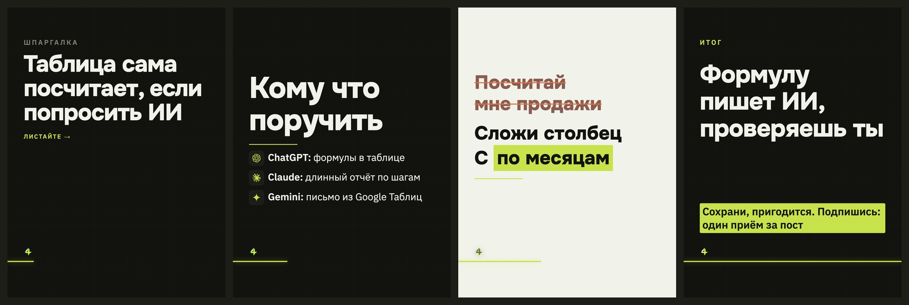

# Стиль «фирменный»

> Собрано `tools_style.py` из кода 16.09.2026.
> Источник правды — `card.ДИЗАЙНЫ["фирменный"]` и `форматы.py`; править там, потом пересобрать.

**Что это:** наш нынешний: Onest и Plex, тонкая сетка

## Откуда взят

Наш собственный, без чужого источника.

## Пример

Один и тот же пост во всех стилях — поэтому разница между папками это разница стилей, а не текста.

Кадры по отдельности, в полном размере — в `кадры/`.

## Дизайн-система

### 1. Палитра

Роли общие для всех стилей канала и не меняются: фон `#12130F`, текст `#F1F3EA`, акцент `#C7E24B`, ржавый `#E2703A`.

Тон кадров: обложка — тёмный, список — тёмный, правка — светлый, финал — тёмный.

Своих цветов не вводит — берёт канальные.

### 2. Иерархия

Гарнитуры: канальные.

Множители кеглей: без своих, базовые из вёрстки.

### 3. Размеры и начертания

Своих кеглей не задаёт, считается от вёрстки.

### 4. Радиусы

прямые углы, радиусов нет

### 5. Границы

границ нет

### 6. Тени и свечения

теней и свечений нет

### 7. Сетка и воздух

Плотность чернил: обложка 6.6%, список 6.3%, правка 9.5%, финал 13.9% (норма 8–15%).

### 8. Карточки

Подложек под текстом нет, текст лежит прямо на холсте.

### 9. Декор

Без декора.

### 10. Картинки

Кот и значки инструментов общие для всех стилей: значки вшиваются данными (`file://` Chrome молча не рисует), кот берётся из `assets/mascot/позы`.

### 11. Адаптация под наш кадр 1620×2160

Форматы: 3к4 и квадрат. Фон холста: любой из общих.

В ротации: **да**

Запретов нет.

## Замеры против наших порогов

Пороги сняты на живых кадрах, а не взяты из веб-рекомендаций: в ленте кадр уменьшен втрое.

| кадр | контраст (норма ≥8:1) | акцент (норма 4–6%) | чернила (норма 8–15%) |
|---|---|---|---|
| обложка | 16.1:1 | 0.19% | 6.6% |
| список | 16.1:1 | 0.31% | 6.3% |
| правка | 5.7:1 | 6.46% | 9.5% |
| финал | 12.6:1 | 7.98% | 13.9% |

## Схожесть с другими стилями

Считается по отрисованным кадрам: структура (куда легли чернила) весит 0,6, палитра — 0,4. Выше 95% значит, что в ленте это читается как один дизайн.

| стиль | общая | структура | палитра |
|---|---|---|---|
| швейцарский ⚠️ дубль | 98.1% | 97.6% | 98.9% |
| чертёж | 92.9% | 89.3% | 98.4% |
| неон | 89.6% | 84.9% | 96.6% |

Полная матрица — в `../README.md`.
