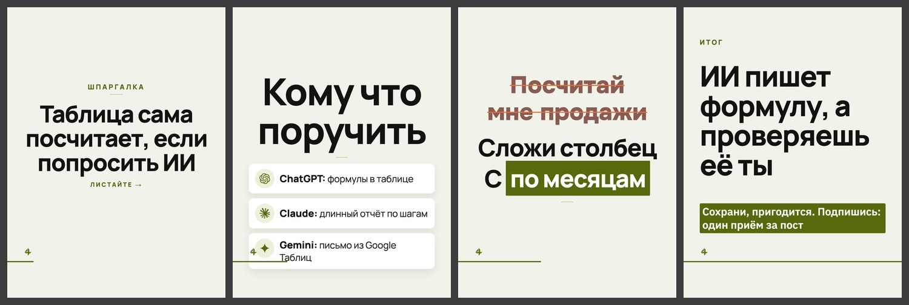

# Дизайн «каталог»

> Собрано `tools_дизайны.py` из кода 15.09.2026. Не править руками:
> дизайн — `card.ДИЗАЙНЫ["каталог"]`, правила — `форматы.py`, потом пересобрать.

**Что это:** светлый кадр, пилюли-теги и карточки с номером и долей.

| | |
|---|---|
| В ротации | да — в `форматы.ДИЗАЙНЫ_ОК` |
| Форматы | 3к4, квадрат |
| Фон | только «чистый» (`форматы.СВОЙ_ФОН`) |
| Гарнитуры | Manrope 400, Manrope 800, Onest 800 |
| Кегли | заголовок ×1.25, мысль ×0.94, над ×0.9 |
| Своя обложка | да |
| Пилюли-метки | да |

## Запреты

- Д-01: нельзя вёрстки «было», «стрелка» на тёмных кадрах
- Д-02: нельзя вёрстки «против»

## Образец

Обложка, «список» (тёмный кадр), «правка» (светлый), финал; формат 3к4, фон «чистый».

