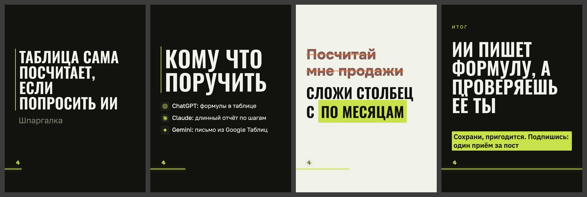

# Дизайн «манифест»

> Собрано `tools_дизайны.py` из кода 15.09.2026. Не править руками:
> дизайн — `card.ДИЗАЙНЫ["манифест"]`, правила — `форматы.py`, потом пересобрать.

**Что это:** узкие заглавные во всю ширину, линейка слева, без акцента.

| | |
|---|---|
| В ротации | да — в `форматы.ДИЗАЙНЫ_ОК` |
| Форматы | 3к4 |
| Фон | любой из сетка, чистый, инверсия, полоса, зерно, линии, контур |
| Гарнитуры | Golos 400, Oswald 600 |
| Кегли | заголовок ×1.18, мысль ×0.92, над ×0.9 |
| Своя обложка | да |
| Пилюли-метки | нет |

## Запреты

- Д-05: нельзя в формате квадрат

## Образец

Обложка, «список» (тёмный кадр), «правка» (светлый), финал; формат 3к4, фон «сетка».

