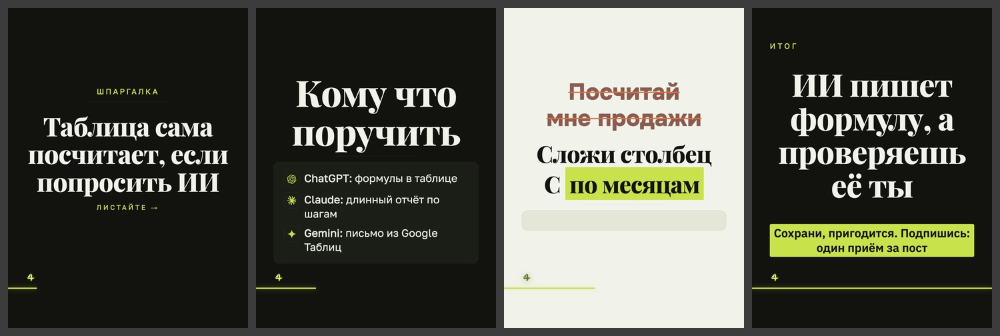

# Дизайн «редакционный»

> Собрано `tools_дизайны.py` из кода 15.09.2026. Не править руками:
> дизайн — `card.ДИЗАЙНЫ["редакционный"]`, правила — `форматы.py`, потом пересобрать.

**Что это:** центрированная колонка, линейка, карточка и пилюли-метки.

| | |
|---|---|
| В ротации | да — в `форматы.ДИЗАЙНЫ_ОК` |
| Форматы | 3к4, квадрат |
| Фон | любой из сетка, чистый, инверсия, полоса, зерно, линии, контур |
| Гарнитуры | Golos 400, Playfair 800, PlayfairIt 700 |
| Кегли | заголовок ×1.1, мысль ×0.98, над ×0.92 |
| Своя обложка | да |
| Пилюли-метки | да |

## Запреты

Нет. Связки, которые ломаются, записывать в `форматы.НЕЛЬЗЯ` с номером из реестра дефектов.

## Образец

Обложка, «список» (тёмный кадр), «правка» (светлый), финал; формат 3к4, фон «сетка».

