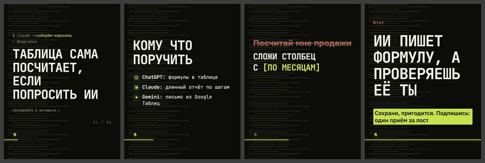

# Дизайн «терминал»

> Собрано `tools_дизайны.py` из кода 15.09.2026. Не править руками:
> дизайн — `card.ДИЗАЙНЫ["терминал"]`, правила — `форматы.py`, потом пересобрать.

**Что это:** консоль: строка команды, окно запроса, подсветка подстановок.

| | |
|---|---|
| В ротации | да — в `форматы.ДИЗАЙНЫ_ОК` |
| Форматы | 3к4, квадрат |
| Фон | только «сетка» (`форматы.СВОЙ_ФОН`) |
| Гарнитуры | JB 400, JB 700 |
| Кегли | заголовок ×0.82, мысль ×0.92, огонь ×0.8 |
| Своя обложка | да |
| Пилюли-метки | нет |

## Запреты

Нет. Связки, которые ломаются, записывать в `форматы.НЕЛЬЗЯ` с номером из реестра дефектов.

## Образец

Обложка, «список» (тёмный кадр), «правка» (светлый), финал; формат 3к4, фон «сетка».

