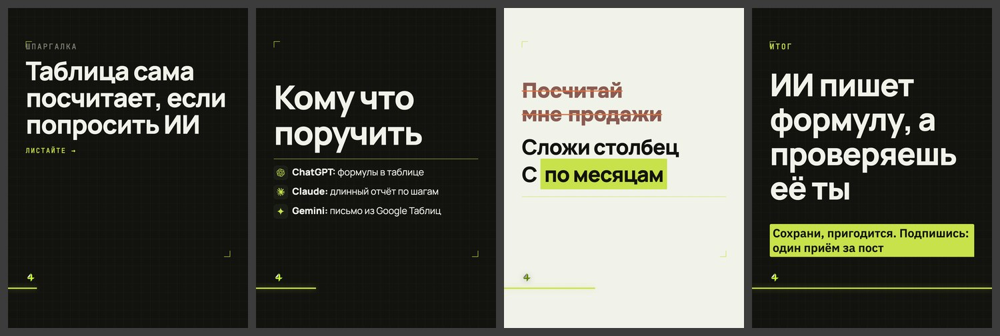

# Дизайн «чертёж»

> Собрано `tools_дизайны.py` из кода 15.09.2026. Не править руками:
> дизайн — `card.ДИЗАЙНЫ["чертёж"]`, правила — `форматы.py`, потом пересобрать.

**Что это:** Manrope и моноширинные пометки, синька, засечки по краям.

| | |
|---|---|
| В ротации | нет — выключен, паспорт карусели его не выберет |
| Форматы | 3к4, квадрат |
| Фон | любой из сетка, чистый, инверсия, полоса, зерно, линии, контур |
| Гарнитуры | JB 400, Manrope 400, Manrope 800 |
| Кегли | заголовок ×1.0, мысль ×0.86 |
| Своя обложка | нет, общая |
| Пилюли-метки | нет |

## Запреты

Нет. Связки, которые ломаются, записывать в `форматы.НЕЛЬЗЯ` с номером из реестра дефектов.

## Образец

Обложка, «список» (тёмный кадр), «правка» (светлый), финал; формат 3к4, фон «сетка».

